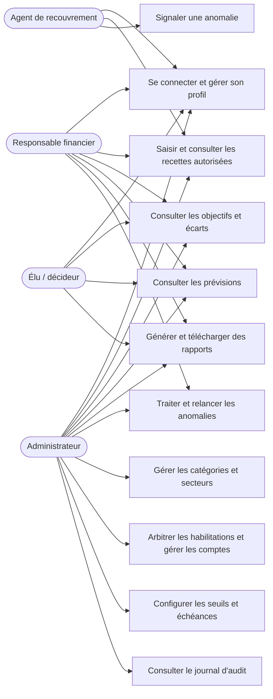
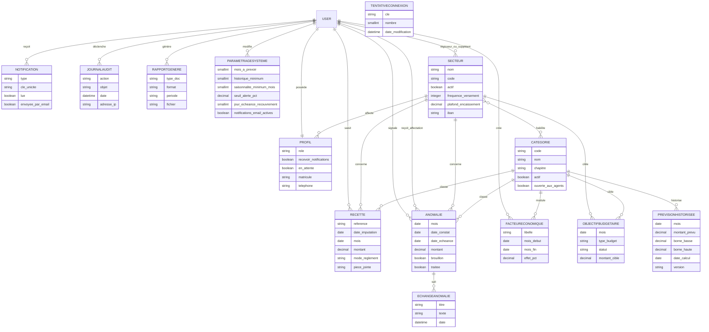
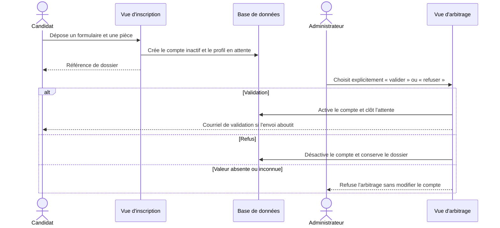
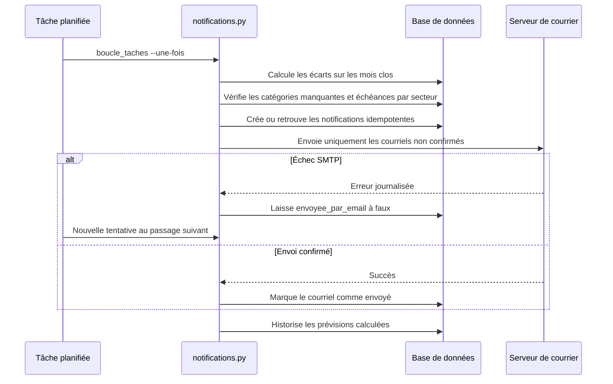

# Modélisation UML

## Acteurs et cas d'utilisation

## Entités et relations

## Séquence d'arbitrage d'une habilitation

## Séquence des rappels et reprises d'e-mails

## Organisation de l'API

L'API expose des routes `GET` pour les référentiels, les recettes, les prévisions, les écarts et le recouvrement. Les routes vérifient l'authentification et les rôles ; les agents ne peuvent consulter que leurs recettes sectorielles et les catégories autorisées. Voir [API.md](./API.md) pour les paramètres et réponses.
